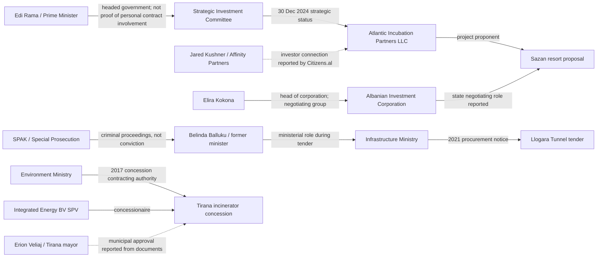

# Albania: Documented Power, Contracts & Projects Network
**Research snapshot: 23 October 2026**  
**Status:** Evidence-indexed investigative network, not a finding of guilt. Each edge below has a source and an explicit limitation. Sources must be rechecked for later updates.

## Visual network

**Legend:** Solid arrows = official/institutional relationship or documented role; dotted arrows = reporting about a relationship or document not independently inspected in this file. Arrow labels are the actual claim, not an assertion of guilt.

## Evidence register: document-backed edges

| ID | From | Relationship | To | Date | Evidence | Classification / limitation |
|---|---|---|---|---|---|
| S01 | Strategic Investment Committee | Granted strategic investor/special procedure status | Atlantic Incubation Partners LLC, Sazan resort | 30 Dec 2024 | [Decision described and linked at Save Albania](https://savealbania.com/evidence-item.php?id=1) | Official decision referenced by evidence repository; verify full decision and annexes |
| S02 | Jared Kushner / Affinity Partners | Investor association reported | Sazan / Atlantic Incubation Partners | 16 Jan 2025 | [Citizens.al investigation](https://citizens.al/en/2025/01/16/from-visitor-to-strategic-investor-how-Jared-Kushner-secured-Sazan/) | Secondary reporting; do not infer all ownership percentages |
| S03 | Elira Kokona | Led state-side negotiating team | Sazan negotiations / Albanian Investment Corporation | Jan–Oct 2025 | [Citizens.al, 3 Mar 2026](https://www.citizens.al/en/2026/03/03/nje-ishull-teresisht-privat-permasat-reale-te-projektit-ne-sazan/) | Investigative report describing official records; obtain minutes and appointments |
| S04 | National Territorial Council | Approved development permit, not construction permit | Zvërnec proposal | 30 Mar 2026 | [Albanian government explanatory record](https://kryeministria.al/en/newsroom/fakte-dhe-informacion-mbi-sazanin-dhe-zvernec/) | Government account; distinguish permit types |
| S05 | Environmental authorities | Required in-depth EIA | Zvërnec development proposal | 15 May 2026 | [Government explanatory record](https://kryeministria.al/en/newsroom/fakte-dhe-informacion-mbi-sazanin-dhe-zvernec/) | Government description specifically concerns Zvërnec; original decision still to be inspected |
| L01 | Ministry of Infrastructure and Energy | Published procurement notice REF-98814-06-22-2021 | Llogara Tunnel | 24 Jun 2021 | [Ministry procurement notice](https://www.infrastruktura.gov.al/en/shpallje/) | Primary ministry source; award and contractors require separate records |
| L02 | SPAK | Prosecuted alleged procurement-equality violation | Belinda Balluku / Llogara tender | 31 Oct 2025 | [SPAK statement reported with proceeding numbers](https://tiranapost.al/english/aktualitet/spak-sqaron-belinda-balluku-u-mor-e-pandehur-per-shkelje-te-barazise--i540809) | Prosecutorial allegation; presumption of innocence |
| L03 | SPAK | Formally charged on offences involving construction contracts | Belinda Balluku | 20 Oct 2026 | [Reuters](https://www.reuters.com/world/albania-formalises-corruption-charges-against-ex-deputy-pm-balluku-2026-10-20/) | News report of charges; not conviction; defendant denies wrongdoing |
| T01 | Ministry of Environment | Signed 30-year concession contract | Integrated Energy BV SPV / Tirana waste facility | 31 Aug 2017 | [Open Data Albania contract analysis](https://ndiqparate.al/?lang=en&p=17198) | Contract relationship; obtain signed contract |
| T02 | Rama / government | Approved an 8% competitive selection bonus, according to published signed documents | Tirana incinerator proposal | 7 Dec 2016 | [CNA report of documents released by opposition](https://www.cna.al/english/aktualitet/dokumentet-firmat-e-rames-veliajt-dhe-agacit-per-aferen-me-incenerato-i383683) | Secondary reporting on opposition-provided documents; independently inspect originals before asserting document authenticity |
| T03 | Erion Veliaj / Municipality of Tirana | Expressed agreement with feasibility/procedure and waste fee, according to reported correspondence | Tirana incinerator | 2017 | [CNA report](https://www.cna.al/english/aktualitet/dokumentet-firmat-e-rames-veliajt-dhe-agacit-per-aferen-me-incenerato-i383683) | Reported correspondence, not judicial finding |
| T04 | European Commission | Reported SPAK incinerator investigations and convictions of several officials | Tirana incinerator case | 2025 report | [European Commission Albania report 2025](https://eur-lex.europa.eu/legal-content/EN/TXT/PDF/?uri=CELEX%3A52025SC0750) | Official monitoring report; check individual judgments before naming convicted persons |
| P01 | Ministry of Finance | Publishes active concession/PPP budget exposure | National PPP portfolio | 2024/25 | [Fiscal Risk Statement 2024](https://financa.gov.al/wp-content/uploads/2025/12/Fiscal-Risk-Statement-2024.pdf) | Primary financial source, not proof of misconduct |

## Unproven links intentionally excluded

- **Bektashi sovereignty proposal → Kushner/Sazan:** No contract, financing document or legislative text found connecting these initiatives.
- **Jewish historical speech → a future Jewish state:** No verified proposal or decision.
- **Shared photographs or meetings → ownership, bribery or conspiracy:** Not a valid evidentiary edge.
- **A company in Panama/Pandora Papers → corruption:** Offshore registration alone is not unlawful.
- **Criminal charge → guilt:** Requires final judicial findings.

## Verification and expansion queue

1. Download and archive AIDA/KIS 30 Dec 2024 Sazan decision, annexes, state negotiation authorizations and beneficial-owner filings for Atlantic Incubation Partners.
2. Obtain Sazan negotiation minutes and identify legal counterparties, state asset terms, EIA, permits, protected-area and military status decisions.
3. Retrieve Llogara procurement notice, award, contract, bidder list, beneficial ownership, amendments, actual payments and SPAK case releases.
4. Obtain original Tirana incinerator contract, Council of Ministers decisions, concession bonus document, municipal correspondence and court judgments.
5. Join each contract to the Ministry of Finance PPP expenditure tables and the QKB beneficial-owner registry.
6. Record every new edge with a unique ID, source URL, document number/date, evidence type, access date, and correction/rebuttal field.
7. Reconcile contradictory government, court and investigative accounts; avoid publishing unsourced accusations.

**Editorial note:** This graph depicts relationships of office, procurement, investment and investigations. It is not a map of criminal associations.

## Primary-source verification round — 23 October 2026

### Corrected geographical attribution

The government’s explanation of the **30 March 2026 development permit** and **15 May 2026 in-depth EIA requirement** concerns **Zvërnec**, not Sazan. Earlier network rows S04/S05 have been corrected. [Government statement](https://kryeministria.al/en/newsroom/fakte-dhe-informacion-mbi-sazanin-dhe-zvernec/).

### Newly verified or strengthened edges

| ID | Source node | Documented relationship | Target node | Date / amount | Source | Confidence and limit |
| --- | --- | --- | --- | --- | --- | --- |
| T05 | Council of Ministers | Approved 8% evaluation bonus for proposed concessionaire | Integrated Energy B.V. | 7 Dec 2016 | [Open Procurement Albania, supporting decisions and tender file](https://openprocurement.al/sq/concession/view/id/5) | Strong documentary register; bonus is not itself proof of an offence |
| T06 | Ministry of Environment | Awarded 30-year concession after one recorded bidder | Integrated Energy B.V. | Award 24 Aug 2017; offer ALL 17,139,106,821 excl. VAT | [Open Procurement Albania](https://openprocurement.al/sq/concession/view/id/5) | Documentary tender register; retrieve signed contract |
| T07 | Ministry of Environment | Signed concession contract no. 6021 Rep., 2894 Kol. | Tirana waste-treatment project | 31 Aug 2017 | [Open Procurement Albania](https://openprocurement.al/sq/concession/view/id/5) | Contract identified in register |
| T08 | GeoGenix BV (formerly Integrated Energy B.V.) | Parent company / shareholder reported from company extract | Integrated Energy BV SPV, NUIS L72031013B | Registry updated 29 Jan 2026 | [OpenCorporates Albania, extracts cited](https://opencorporates.al/en/nuis/L72031013B) | Registry-derived; beneficial natural-person owners need separate verification |
| L04 | SPAK | Identifies Balluku and five procurement-committee officials in proceedings concerning alleged tender interference | Llogara Tunnel | Proceeding no. 136/2025; Llogara fund ceiling ALL 18,967,810,952 excl. VAT | [SPAK, 20 Nov 2025](https://spak.gov.al/njoftim-per-shtyp-date-20-11-2025-2/) | Primary prosecutorial statement; allegations only |
| S06 | Strategic Investment Committee chaired by Rama | Granted strategic investor status | Atlantic Incubation Partners LLC / Sazan proposal | 30 Dec 2024 | [Reuters, 16 Jan 2025](https://www.reuters.com/business/albania-approves-luxury-resort-project-linked-jared-kushners-company-2025-01-16/); [AIDA decision indexed](https://www.savealbania.com/evidence-item.php?id=1) | Government decision referenced, direct signed original still to be independently inspected |
| S07 | State negotiation group led by Elira Kokona | Held ten meetings, according to records examined by journalists | Sazan proposal | Jan–Oct 2025 | [Citizens.al, 3 Mar 2026](https://www.citizens.al/en/2026/03/03/nje-ishull-teresisht-privat-permasat-reale-te-projektit-ne-sazan/) | Reported examination of meeting records; obtain minutes for primary verification |

### Important methodological corrections

- The **Llogara construction contract** must not be confused with its **separate supervision procurement** (REF-12982-11-24-2021).
- The Tirana incinerator’s Dutch parent company is a **corporate relationship**, not identification of all ultimate beneficial owners.
- The Sazan project and Zvërnec project have distinct land parcels, approval processes and environmental requirements.
- For the alleged Llogara offences, identify procedural status and defendants' responses before describing guilt.
- An 8% bid evaluation bonus or single-bidder procurement is a documented feature of a process; neither alone establishes criminal conduct.

### Next document acquisition checklist

- [ ] Download the signed AIDA/KIS Sazan decision 23/2024 and annexes
- [ ] Obtain QKB certified current and historical extracts for Atlantic Incubation Partners
- [ ] Obtain the signed Tirana concession and the Dutch company-register chain to natural persons
- [ ] Obtain the main Llogara works award/contract, excluding the supervision tender
- [ ] Retrieve the actual Zvërnec permit, environmental screening decision and cadastral parcel list
- [ ] Reconcile SPAK procedural updates and court judgments against each named official

## Ultimate beneficial ownership investigation — 23 October 2026

**Do not conflate** direct shareholders, ultimate beneficial owners, directors, project promoters, political officials, or beneficial owners at different historical dates. An ownership edge needs an entity number, percentage, effective date and source.

### A. Tirana incinerator — historically documented ownership (10 May 2022)

**Project:** Tirana waste treatment concession. **Albanian concessionaire:** Integrated Energy BV SPV, NUIS **L72031013B**. **Direct parent:** GeoGenix BV, formerly Integrated Energy B.V., Netherlands company no. **66671752**, 100% of the Albanian SPV.

The historical QKB beneficial-ownership extract, reproduced in [OpenCorporates Albania](https://opencorporates.al/en/nuis/L72031013B), records:

| Ultimate person | Historical effective interest | Ownership path | Evidence status |
| --- | ---: | --- | --- |
| Alberto Presezzi | 40% | Presezzi → Bruno Presezzi S.p.A. → Franco Tosi Meccanica S.p.A. → GeoGenix BV → Integrated Energy BV SPV | Historical QKB extract, 10 May 2022 |
| Max Abitbol | 20% | 50% Icare Energy SA → Icare Holding SA (100%) → GeoGenix BV (40%) → SPV | Historical QKB extract, 10 May 2022 |
| Dominique Marcelle Obadia Abitboll | 20% | 50% Icare Energy SA → Icare Holding SA (100%) → GeoGenix BV (40%) → SPV | Historical QKB extract, 10 May 2022 |
| Other minority holders | 20% | Not individually identified in cited beneficial-owner extract | **Unknown**, not evidence of illicit ownership |

**Timeline:** Klodian Zoto was formerly an administrator of the Dutch parent in 2016–2018, not thereby established as the current owner. The Albanian concessionaire entered preventive seizure administration in August 2023, and its listed administrator was Indrit Karaj in January 2026. **Seizure and administration do not change the meaning of the historical 2022 share percentages.**

**Official-role connections:** The 2016 company letter was addressed to Environment Minister Lefter Koka and copied to Tirana Mayor Erion Veliaj; the 2017 concession was contracted by the Ministry of Environment. These are **documented official correspondence and institutional decision-making edges**, not proof that those officials owned shares in the concessionaire. [Registry-derived document account](https://opencorporates.al/en/nuis/L72031013B); [procurement file](https://openprocurement.al/sq/concession/view/id/5).

### B. Sazan — strategic-investor applicant versus operating vehicle

**Applicant:** Atlantic Incubation Partners LLC, Delaware, EIN **92-3329707**, received strategic-investor status through Strategic Investment Committee **Decision 23, 30 December 2024** for the proposed €1.4bn Sazan resort. The [Delaware / Albanian registry-derived profile](https://opencorporates.al/en/nipt/7390750) **does not disclose its ultimate owners**. Corporation Service Company is its registered agent/administrator listing, not proof of beneficial ownership. [AIDA strategic investment register](https://aida.gov.al/wp-content/uploads/2026/02/00.-REGJISTRI-AIDA-2025_30112025.pdf).

**Implementation vehicle:** BIRN's April 2026 examination of QKB filings reports that **Sazan Operations**, founded 1 April 2026, is ultimately controlled by **Ramez and Mohamad Al-Khayyat** through a chain of six companies. The report identifies **five unnamed Albanian minority shareholders holding a 24% stake in Blue Industries Investment Holding BV**, one entity in the related structure. **Do not represent that 24% as a direct share of the Sazan resort or of Atlantic Incubation Partners without a complete cap table.** [BIRN investigation republished by Balkanweb](https://www.balkanweb.com/en/Two-Qatari-billionaires-and-a-complex-network-of-companies-behind-the-Sazan-project/).

**Jared Kushner:** Associated with the project and described as a partner by public reporting. The precise personal equity percentage and ownership chain linking his interests to Atlantic Incubation Partners and Sazan Operations remain **unverified**. A [recent Exit investigation](https://exit.al/en/exit-explains/kushners-response-on-albania-what-the-record-shows-i48098) discusses remaining disclosure gaps. His political family connections are not evidence of unlawful benefit.

**Government connections:** The Strategic Investment Committee's approval and the Ministry of Defense's reported assumption of Sazan demining costs (under a December 2025 decision) are governmental actions requiring review of signed annexes, actual budget expenditures and project obligations. The reported transfer of costs should not be described as a completed payment without expenditure records.

### C. Zvërnec — distinct project, not the same land or ownership chain

Reporting links Kushner-associated investors, Qatar-registered Sazan Real Estate Development and Qatari partners to Zvërnec, but the legal entities, land acquisitions, minority interests and approvals must be traced **separately from Sazan**. [Exit Explains](https://exit.al/en/exit-explains/kushners-response-on-albania-what-the-record-shows-i48098).

### D. Llogara — construction vs maintenance contracts

A 2025 **maintenance and safety** tender reportedly went to the A-M / Gjoka Konstruksion consortium for approximately ALL 230m over four years. This is **not** the 2021 construction tender under SPAK investigation. Do not connect maintenance-contract owners to the alleged 2021 procurement interference without additional records. [Tender reporting](https://acp.al/news/26654/230-mln-leke-per-tunelin-e-llogarase-arrsh-shpall-fituesin-per-mirembajtjen-dhe-sigurine/).

### E. Evidence-grade ownership edges for the interactive network

| Edge | Confidence | Source |
| --- | --- | --- |
| GeoGenix BV → Integrated Energy BV SPV: 100% direct shareholder | High, registry-derived | OpenCorporates Albania/QKB extract |
| Presezzi → incinerator SPV: historical 40% indirect | High for 10 May 2022, not necessarily current | QKB historical UBO extract |
| Max Abitbol → incinerator SPV: historical 20% indirect | High for 10 May 2022 | QKB historical UBO extract |
| Dominique Obadia Abitboll → incinerator SPV: historical 20% indirect | High for 10 May 2022 | QKB historical UBO extract |
| Atlantic Incubation Partners → Sazan strategic applicant | High, official decision reproduced in registry | Decision 23/2024 |
| Al-Khayyat brothers → Sazan Operations control | Medium-high, BIRN reading of QKB filings | BIRN April 2026 |
| Five unnamed Albanians → 24% of Blue Industries Investment Holding BV | Medium-high, reported filings; **names unknown** | BIRN April 2026 |
| Kushner → precise shareholding in Atlantic/Sazan Operations | **Not established** | Do not draw ownership edge |
| Any official → private beneficial ownership of these vehicles | **Not established by the above records** | Do not draw ownership edge |

### Required next evidence acquisitions

1. Obtain **certified current and historical QKB UBO extracts** for all Albanian vehicles, including effective dates and changes after seizure.
2. Obtain the **Dutch KvK register filings** for GeoGenix BV, Blue Industries Investment Holding BV and intermediate holdings, and distinguish legal shareholders from UBO disclosures.
3. Obtain **Delaware corporate filings and voluntary ownership disclosures** for Atlantic Incubation Partners LLC; Delaware public searches generally do not identify natural-person owners.
4. Obtain signed **Sazan decision 23/2024, its annexes and the December 2025 extension**, plus the state-company agreement and Ministry of Defense demining cost authorization.
5. Identify the **actual 2021 Llogara construction consortium** and retrieve its award/contract, rather than importing the 2025 maintenance consortium.
6. Seek comment and supporting records from each company and relevant ministry; log denials and corrections alongside claims.

**Interpretation:** The findings establish ownership and institutional decision relationships, not an illicit conspiracy. Unknown beneficial owners remain unknown; do not fill gaps by ethnic, religious or political association.
