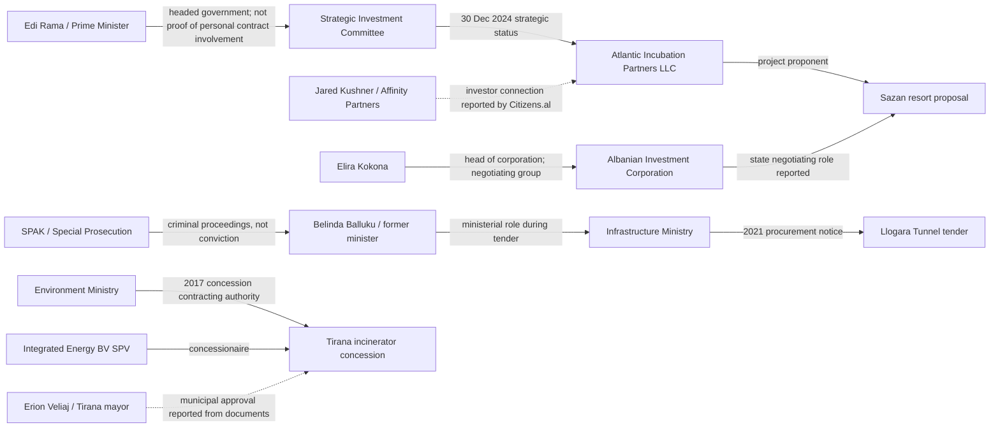

# Albania: Documented Power, Contracts & Projects Network
**Research snapshot: 23 October 2026**  
**Status:** Evidence-indexed investigative network, not a finding of guilt. Each edge below has a source and an explicit limitation. Sources must be rechecked for later updates.

## Visual network

**Legend:** Solid arrows = official/institutional relationship or documented role; dotted arrows = reporting about a relationship or document not independently inspected in this file. Arrow labels are the actual claim, not an assertion of guilt.

## Evidence register: document-backed edges

| ID | From | Relationship | To | Date | Evidence | Classification / limitation |
|---|---|---|---|---|---|
| S01 | Strategic Investment Committee | Granted strategic investor/special procedure status | Atlantic Incubation Partners LLC, Sazan resort | 30 Dec 2024 | [Decision described and linked at Save Albania](https://savealbania.com/evidence-item.php?id=1) | Official decision referenced by evidence repository; verify full decision and annexes |
| S02 | Jared Kushner / Affinity Partners | Investor association reported | Sazan / Atlantic Incubation Partners | 16 Jan 2025 | [Citizens.al investigation](https://citizens.al/en/2025/01/16/from-visitor-to-strategic-investor-how-Jared-Kushner-secured-Sazan/) | Secondary reporting; do not infer all ownership percentages |
| S03 | Elira Kokona | Led state-side negotiating team | Sazan negotiations / Albanian Investment Corporation | Jan–Oct 2025 | [Citizens.al, 3 Mar 2026](https://www.citizens.al/en/2026/03/03/nje-ishull-teresisht-privat-permasat-reale-te-projektit-ne-sazan/) | Investigative report describing official records; obtain minutes and appointments |
| S04 | National Territorial Council | Approved development permit, not construction permit | Zvërnec proposal | 30 Mar 2026 | [Albanian government explanatory record](https://kryeministria.al/en/newsroom/fakte-dhe-informacion-mbi-sazanin-dhe-zvernec/) | Government account; distinguish permit types |
| S05 | Environmental authorities | Required in-depth EIA | Zvërnec development proposal | 15 May 2026 | [Government explanatory record](https://kryeministria.al/en/newsroom/fakte-dhe-informacion-mbi-sazanin-dhe-zvernec/) | Government description specifically concerns Zvërnec; original decision still to be inspected |
| L01 | Ministry of Infrastructure and Energy | Published procurement notice REF-98814-06-22-2021 | Llogara Tunnel | 24 Jun 2021 | [Ministry procurement notice](https://www.infrastruktura.gov.al/en/shpallje/) | Primary ministry source; award and contractors require separate records |
| L02 | SPAK | Prosecuted alleged procurement-equality violation | Belinda Balluku / Llogara tender | 31 Oct 2025 | [SPAK statement reported with proceeding numbers](https://tiranapost.al/english/aktualitet/spak-sqaron-belinda-balluku-u-mor-e-pandehur-per-shkelje-te-barazise--i540809) | Prosecutorial allegation; presumption of innocence |
| L03 | SPAK | Formally charged on offences involving construction contracts | Belinda Balluku | 20 Oct 2026 | [Reuters](https://www.reuters.com/world/albania-formalises-corruption-charges-against-ex-deputy-pm-balluku-2026-10-20/) | News report of charges; not conviction; defendant denies wrongdoing |
| T01 | Ministry of Environment | Signed 30-year concession contract | Integrated Energy BV SPV / Tirana waste facility | 31 Aug 2017 | [Open Data Albania contract analysis](https://ndiqparate.al/?lang=en&p=17198) | Contract relationship; obtain signed contract |
| T02 | Rama / government | Approved an 8% competitive selection bonus, according to published signed documents | Tirana incinerator proposal | 7 Dec 2016 | [CNA report of documents released by opposition](https://www.cna.al/english/aktualitet/dokumentet-firmat-e-rames-veliajt-dhe-agacit-per-aferen-me-incenerato-i383683) | Secondary reporting on opposition-provided documents; independently inspect originals before asserting document authenticity |
| T03 | Erion Veliaj / Municipality of Tirana | Expressed agreement with feasibility/procedure and waste fee, according to reported correspondence | Tirana incinerator | 2017 | [CNA report](https://www.cna.al/english/aktualitet/dokumentet-firmat-e-rames-veliajt-dhe-agacit-per-aferen-me-incenerato-i383683) | Reported correspondence, not judicial finding |
| T04 | European Commission | Reported SPAK incinerator investigations and convictions of several officials | Tirana incinerator case | 2025 report | [European Commission Albania report 2025](https://eur-lex.europa.eu/legal-content/EN/TXT/PDF/?uri=CELEX%3A52025SC0750) | Official monitoring report; check individual judgments before naming convicted persons |
| P01 | Ministry of Finance | Publishes active concession/PPP budget exposure | National PPP portfolio | 2024/25 | [Fiscal Risk Statement 2024](https://financa.gov.al/wp-content/uploads/2025/12/Fiscal-Risk-Statement-2024.pdf) | Primary financial source, not proof of misconduct |

## Unproven links intentionally excluded

- **Bektashi sovereignty proposal → Kushner/Sazan:** No contract, financing document or legislative text found connecting these initiatives.
- **Jewish historical speech → a future Jewish state:** No verified proposal or decision.
- **Shared photographs or meetings → ownership, bribery or conspiracy:** Not a valid evidentiary edge.
- **A company in Panama/Pandora Papers → corruption:** Offshore registration alone is not unlawful.
- **Criminal charge → guilt:** Requires final judicial findings.

## Verification and expansion queue

1. Download and archive AIDA/KIS 30 Dec 2024 Sazan decision, annexes, state negotiation authorizations and beneficial-owner filings for Atlantic Incubation Partners.
2. Obtain Sazan negotiation minutes and identify legal counterparties, state asset terms, EIA, permits, protected-area and military status decisions.
3. Retrieve Llogara procurement notice, award, contract, bidder list, beneficial ownership, amendments, actual payments and SPAK case releases.
4. Obtain original Tirana incinerator contract, Council of Ministers decisions, concession bonus document, municipal correspondence and court judgments.
5. Join each contract to the Ministry of Finance PPP expenditure tables and the QKB beneficial-owner registry.
6. Record every new edge with a unique ID, source URL, document number/date, evidence type, access date, and correction/rebuttal field.
7. Reconcile contradictory government, court and investigative accounts; avoid publishing unsourced accusations.

**Editorial note:** This graph depicts relationships of office, procurement, investment and investigations. It is not a map of criminal associations.

## Primary-source verification round — 23 October 2026

### Corrected geographical attribution

The government’s explanation of the **30 March 2026 development permit** and **15 May 2026 in-depth EIA requirement** concerns **Zvërnec**, not Sazan. Earlier network rows S04/S05 have been corrected. [Government statement](https://kryeministria.al/en/newsroom/fakte-dhe-informacion-mbi-sazanin-dhe-zvernec/).

### Newly verified or strengthened edges

| ID | Source node | Documented relationship | Target node | Date / amount | Source | Confidence and limit |
| --- | --- | --- | --- | --- | --- | --- |
| T05 | Council of Ministers | Approved 8% evaluation bonus for proposed concessionaire | Integrated Energy B.V. | 7 Dec 2016 | [Open Procurement Albania, supporting decisions and tender file](https://openprocurement.al/sq/concession/view/id/5) | Strong documentary register; bonus is not itself proof of an offence |
| T06 | Ministry of Environment | Awarded 30-year concession after one recorded bidder | Integrated Energy B.V. | Award 24 Aug 2017; offer ALL 17,139,106,821 excl. VAT | [Open Procurement Albania](https://openprocurement.al/sq/concession/view/id/5) | Documentary tender register; retrieve signed contract |
| T07 | Ministry of Environment | Signed concession contract no. 6021 Rep., 2894 Kol. | Tirana waste-treatment project | 31 Aug 2017 | [Open Procurement Albania](https://openprocurement.al/sq/concession/view/id/5) | Contract identified in register |
| T08 | GeoGenix BV (formerly Integrated Energy B.V.) | Parent company / shareholder reported from company extract | Integrated Energy BV SPV, NUIS L72031013B | Registry updated 29 Jan 2026 | [OpenCorporates Albania, extracts cited](https://opencorporates.al/en/nuis/L72031013B) | Registry-derived; beneficial natural-person owners need separate verification |
| L04 | SPAK | Identifies Balluku and five procurement-committee officials in proceedings concerning alleged tender interference | Llogara Tunnel | Proceeding no. 136/2025; Llogara fund ceiling ALL 18,967,810,952 excl. VAT | [SPAK, 20 Nov 2025](https://spak.gov.al/njoftim-per-shtyp-date-20-11-2025-2/) | Primary prosecutorial statement; allegations only |
| S06 | Strategic Investment Committee chaired by Rama | Granted strategic investor status | Atlantic Incubation Partners LLC / Sazan proposal | 30 Dec 2024 | [Reuters, 16 Jan 2025](https://www.reuters.com/business/albania-approves-luxury-resort-project-linked-jared-kushners-company-2025-01-16/); [AIDA decision indexed](https://www.savealbania.com/evidence-item.php?id=1) | Government decision referenced, direct signed original still to be independently inspected |
| S07 | State negotiation group led by Elira Kokona | Held ten meetings, according to records examined by journalists | Sazan proposal | Jan–Oct 2025 | [Citizens.al, 3 Mar 2026](https://www.citizens.al/en/2026/03/03/nje-ishull-teresisht-privat-permasat-reale-te-projektit-ne-sazan/) | Reported examination of meeting records; obtain minutes for primary verification |

### Important methodological corrections

- The **Llogara construction contract** must not be confused with its **separate supervision procurement** (REF-12982-11-24-2021).
- The Tirana incinerator’s Dutch parent company is a **corporate relationship**, not identification of all ultimate beneficial owners.
- The Sazan project and Zvërnec project have distinct land parcels, approval processes and environmental requirements.
- For the alleged Llogara offences, identify procedural status and defendants' responses before describing guilt.
- An 8% bid evaluation bonus or single-bidder procurement is a documented feature of a process; neither alone establishes criminal conduct.

### Next document acquisition checklist

- [ ] Download the signed AIDA/KIS Sazan decision 23/2024 and annexes
- [ ] Obtain QKB certified current and historical extracts for Atlantic Incubation Partners
- [ ] Obtain the signed Tirana concession and the Dutch company-register chain to natural persons
- [ ] Obtain the main Llogara works award/contract, excluding the supervision tender
- [ ] Retrieve the actual Zvërnec permit, environmental screening decision and cadastral parcel list
- [ ] Reconcile SPAK procedural updates and court judgments against each named official

## Ultimate beneficial ownership investigation — 23 October 2026

**Do not conflate** direct shareholders, ultimate beneficial owners, directors, project promoters, political officials, or beneficial owners at different historical dates. An ownership edge needs an entity number, percentage, effective date and source.

### A. Tirana incinerator — historically documented ownership (10 May 2022)

**Project:** Tirana waste treatment concession. **Albanian concessionaire:** Integrated Energy BV SPV, NUIS **L72031013B**. **Direct parent:** GeoGenix BV, formerly Integrated Energy B.V., Netherlands company no. **66671752**, 100% of the Albanian SPV.

The historical QKB beneficial-ownership extract, reproduced in [OpenCorporates Albania](https://opencorporates.al/en/nuis/L72031013B), records:

| Ultimate person | Historical effective interest | Ownership path | Evidence status |
| --- | ---: | --- | --- |
| Alberto Presezzi | 40% | Presezzi → Bruno Presezzi S.p.A. → Franco Tosi Meccanica S.p.A. → GeoGenix BV → Integrated Energy BV SPV | Historical QKB extract, 10 May 2022 |
| Max Abitbol | 20% | 50% Icare Energy SA → Icare Holding SA (100%) → GeoGenix BV (40%) → SPV | Historical QKB extract, 10 May 2022 |
| Dominique Marcelle Obadia Abitboll | 20% | 50% Icare Energy SA → Icare Holding SA (100%) → GeoGenix BV (40%) → SPV | Historical QKB extract, 10 May 2022 |
| Other minority holders | 20% | Not individually identified in cited beneficial-owner extract | **Unknown**, not evidence of illicit ownership |

**Timeline:** Klodian Zoto was formerly an administrator of the Dutch parent in 2016–2018, not thereby established as the current owner. The Albanian concessionaire entered preventive seizure administration in August 2023, and its listed administrator was Indrit Karaj in January 2026. **Seizure and administration do not change the meaning of the historical 2022 share percentages.**

**Official-role connections:** The 2016 company letter was addressed to Environment Minister Lefter Koka and copied to Tirana Mayor Erion Veliaj; the 2017 concession was contracted by the Ministry of Environment. These are **documented official correspondence and institutional decision-making edges**, not proof that those officials owned shares in the concessionaire. [Registry-derived document account](https://opencorporates.al/en/nuis/L72031013B); [procurement file](https://openprocurement.al/sq/concession/view/id/5).

### B. Sazan — strategic-investor applicant versus operating vehicle

**Applicant:** Atlantic Incubation Partners LLC, Delaware, EIN **92-3329707**, received strategic-investor status through Strategic Investment Committee **Decision 23, 30 December 2024** for the proposed €1.4bn Sazan resort. The [Delaware / Albanian registry-derived profile](https://opencorporates.al/en/nipt/7390750) **does not disclose its ultimate owners**. Corporation Service Company is its registered agent/administrator listing, not proof of beneficial ownership. [AIDA strategic investment register](https://aida.gov.al/wp-content/uploads/2026/02/00.-REGJISTRI-AIDA-2025_30112025.pdf).

**Implementation vehicle:** BIRN's April 2026 examination of QKB filings reports that **Sazan Operations**, founded 1 April 2026, is ultimately controlled by **Ramez and Mohamad Al-Khayyat** through a chain of six companies. The report identifies **five unnamed Albanian minority shareholders holding a 24% stake in Blue Industries Investment Holding BV**, one entity in the related structure. **Do not represent that 24% as a direct share of the Sazan resort or of Atlantic Incubation Partners without a complete cap table.** [BIRN investigation republished by Balkanweb](https://www.balkanweb.com/en/Two-Qatari-billionaires-and-a-complex-network-of-companies-behind-the-Sazan-project/).

**Jared Kushner:** Associated with the project and described as a partner by public reporting. The precise personal equity percentage and ownership chain linking his interests to Atlantic Incubation Partners and Sazan Operations remain **unverified**. A [recent Exit investigation](https://exit.al/en/exit-explains/kushners-response-on-albania-what-the-record-shows-i48098) discusses remaining disclosure gaps. His political family connections are not evidence of unlawful benefit.

**Government connections:** The Strategic Investment Committee's approval and the Ministry of Defense's reported assumption of Sazan demining costs (under a December 2025 decision) are governmental actions requiring review of signed annexes, actual budget expenditures and project obligations. The reported transfer of costs should not be described as a completed payment without expenditure records.

### C. Zvërnec — distinct project, not the same land or ownership chain

Reporting links Kushner-associated investors, Qatar-registered Sazan Real Estate Development and Qatari partners to Zvërnec, but the legal entities, land acquisitions, minority interests and approvals must be traced **separately from Sazan**. [Exit Explains](https://exit.al/en/exit-explains/kushners-response-on-albania-what-the-record-shows-i48098).

### D. Llogara — construction vs maintenance contracts

A 2025 **maintenance and safety** tender reportedly went to the A-M / Gjoka Konstruksion consortium for approximately ALL 230m over four years. This is **not** the 2021 construction tender under SPAK investigation. Do not connect maintenance-contract owners to the alleged 2021 procurement interference without additional records. [Tender reporting](https://acp.al/news/26654/230-mln-leke-per-tunelin-e-llogarase-arrsh-shpall-fituesin-per-mirembajtjen-dhe-sigurine/).

### E. Evidence-grade ownership edges for the interactive network

| Edge | Confidence | Source |
| --- | --- | --- |
| GeoGenix BV → Integrated Energy BV SPV: 100% direct shareholder | High, registry-derived | OpenCorporates Albania/QKB extract |
| Presezzi → incinerator SPV: historical 40% indirect | High for 10 May 2022, not necessarily current | QKB historical UBO extract |
| Max Abitbol → incinerator SPV: historical 20% indirect | High for 10 May 2022 | QKB historical UBO extract |
| Dominique Obadia Abitboll → incinerator SPV: historical 20% indirect | High for 10 May 2022 | QKB historical UBO extract |
| Atlantic Incubation Partners → Sazan strategic applicant | High, official decision reproduced in registry | Decision 23/2024 |
| Al-Khayyat brothers → Sazan Operations control | Medium-high, BIRN reading of QKB filings | BIRN April 2026 |
| Five unnamed Albanians → 24% of Blue Industries Investment Holding BV | Medium-high, reported filings; **names unknown** | BIRN April 2026 |
| Kushner → precise shareholding in Atlantic/Sazan Operations | **Not established** | Do not draw ownership edge |
| Any official → private beneficial ownership of these vehicles | **Not established by the above records** | Do not draw ownership edge |

### Required next evidence acquisitions

1. Obtain **certified current and historical QKB UBO extracts** for all Albanian vehicles, including effective dates and changes after seizure.
2. Obtain the **Dutch KvK register filings** for GeoGenix BV, Blue Industries Investment Holding BV and intermediate holdings, and distinguish legal shareholders from UBO disclosures.
3. Obtain **Delaware corporate filings and voluntary ownership disclosures** for Atlantic Incubation Partners LLC; Delaware public searches generally do not identify natural-person owners.
4. Obtain signed **Sazan decision 23/2024, its annexes and the December 2025 extension**, plus the state-company agreement and Ministry of Defense demining cost authorization.
5. Identify the **actual 2021 Llogara construction consortium** and retrieve its award/contract, rather than importing the 2025 maintenance consortium.
6. Seek comment and supporting records from each company and relevant ministry; log denials and corrections alongside claims.

**Interpretation:** The findings establish ownership and institutional decision relationships, not an illicit conspiracy. Unknown beneficial owners remain unknown; do not fill gaps by ethnic, religious or political association.

## Organizations that honored Rama — screening register (23 October 2026)

**Not exhaustive.** An award, honorary role, state office, formal membership and business contract are different relationships. Names and current roles require issuer verification before publication.

| Organization / institution | Rama relationship | Named leader at time | Primary / institutional reference | Financial link to Albanian public contracts |
| --- | --- | --- | --- | --- |
| Combat Antisemitism Movement (CAM) | Global Leadership Award, Sept 2024 | CEO Sacha Roytman; advisory chair Natan Sharansky | https://combatantisemitism.org/cam-news/prime-minister-of-albania-edi-rama-honored-for-leadership-in-fight-against-antisemitism-at-un-general-assembly-event/ | **Not established**; search required |
| Center for Jewish Impact | Award event co-organizer | Chairman Robert Singer | Same CAM event source | **Not established** |
| Vital Voices Global Partnership | Voices of Solidarity recognition, Dec 2021 | President/CEO Alyse Nelson; co-founder Hillary Clinton | https://www.kryeministria.al/en/newsroom/kryeministri-rama-nderohet-me-cmimin-e-solidaritetit-nga-vital-voices-global-partnership/ | **Not established** |
| Sesame Workshop | Joan Ganz Cooney Global Leadership Award, June 2022 | President/CEO Sherrie Westin | https://www.kryeministria.al/en/newsroom/shba-kryeministri-rama-nderohet-me-cmimin-prestigjoz-nga-organizata-sesame-workshop/ | **Not established** |
| Israeli Presidency | Presidential Medal of Honor, April 2025 | President Isaac Herzog | https://www.kryeministria.al/en/newsroom/jeruzalem-kryeministri-rama-nderohet-me-medaljen-presidenciale-te-nderit-te-izraelit/ | No personal payment established |
| UAE Presidency | Order of Zayed, Jan 2026 | President Mohamed bin Zayed Al Nahyan | UAE Foreign Ministry / government announcements | State-to-state cooperation and separate Eagle Hills investment are documented; **no award-for-contract exchange established** |
| OSCE | Albania's rotating Chairmanship-in-Office, 2020 | Rama as chairman-in-office | https://www.osce.org/chairmanship | State role, not private award or membership |

### UAE / Durrës Marina: a documented investment network, not an inferred award-for-contract arrangement

The Durrës Port Authority describes a 10 August 2022 memorandum of understanding between Eagle Hills Real Estate Development, represented by **Mohamed Alabbar**, and Albanian Seaports Development Company, represented by **Erlis Hereni**. The project followed Strategic Investment Committee Decision 14/6 of 2 December 2021. [Port Authority record](https://durresport.al/durres-yachts-and-marina-signing-ceremony-of-the-memorandum-of-understanding-10-august-2022/). Registry-derived reporting identifies a historical indirect **40.18%** interest of Alabbar in Eagle Hills and a project-vehicle structure reported as **67% Eagle Hills / 33% Albanian Seaports Development Company**; the date and company IDs need confirmation against certified QKB extracts. [Registry-derived profile](https://opencorporates.al/en/nipt/m11726006h).

**No evidence identified here** that the UAE president personally owned this project, received its proceeds, or conferred the 2026 honor in exchange for any project decision.

## Certified-record acquisition and right-of-reply workflow

### Requested original documents (not yet obtained or certified)

| Priority | Custodian | Specific records | Why needed | Status |
| --- | --- | --- | --- | --- |
| P1 | QKB (Albanian National Business Center) | Certified current and historical company + beneficial-owner extracts for Integrated Energy BV SPV (NUIS L72031013B), Sazan Operations, Durrës Marina (NUIS M31423504A), and all Albanian intermediate entities | Confirm ultimate natural persons, effective dates, changes, pledges and directors | **Request pending — not submitted** |
| P1 | Dutch Kamer van Koophandel (KvK) | Historical shareholder/filing extracts for GeoGenix BV (formerly Integrated Energy B.V.), Blue Industries Investment Holding BV and every intermediary in ownership chain | Verify parent stakes and reconcile UBO assertions | **Request pending — not submitted** |
| P1 | AIDA / Strategic Investment Committee | Signed Sazan Decision 23/2024, annexes, extensions, correspondence and implementation agreement | Determine legal beneficiary, land rights, obligations and state commitments | **Request pending — not submitted** |
| P1 | Ministry of Environment / concession archive | Signed 2017 Tirana incinerator concession, all amendments, payment schedules and performance reports | Identify actual contractual rights, costs and beneficiaries | **Request pending — not submitted** |
| P1 | APP / Infrastructure Ministry | 2021 Llogara construction tender award, contract, consortium agreement, amendments, payment records (not 2025 maintenance tender) | Identify actual construction counterparties and payment trail | **Request pending — not submitted** |
| P2 | Albanian Investment Corporation / Defense Ministry | Sazan negotiation minutes, state-asset valuation and demining decision/payment evidence | Quantify state contributions | **Request pending — not submitted** |
| P2 | Durrës Port Authority / Ministry of Finance | Durrës Marina investment agreement, land valuation, guarantees, tax concessions, dividends and audited accounts | Test public benefit and financial exposure | **Request pending — not submitted** |
| P2 | Delaware Division of Corporations / company | Atlantic Incubation Partners LLC registration and voluntary beneficial-ownership/capitalization disclosure | Public Delaware registration alone may not identify ultimate owners | **Request pending — not submitted** |

### Draft document request (Albanian)

**Subjekti: Kërkesë për informacion dhe kopje dokumentesh — [projekti / vendimi]**

Në kuadër të një hulumtimi publik mbi transparencën e investimeve, koncesioneve dhe pronësinë përfituese, kërkojmë kopje elektronike të [numri dhe data e vendimit/kontratës], anekseve, ndryshimeve, vlerësimit të pronës publike, pagesave dhe identitetit të subjekteve kontraktuese, sipas rregullave për qasjen në informacionin publik. Ju lutemi tregoni çdo pjesë të kufizuar ligjërisht, bazën për kufizimin dhe mundësinë e qasjes së pjesshme. Ju lutemi të konfirmoni numrin e protokollit dhe afatin e përgjigjes.

### Draft right-of-reply to companies (English)

**Subject: Request for comment and supporting documents — Albania development/concession investigation**

We are preparing a documented public-interest investigation into [project], focusing on corporate ownership, contractual rights, government decisions and public financial commitments. Please confirm (1) the current direct and ultimate beneficial owners, including effective dates and ownership percentages; (2) all project vehicles and material affiliates; (3) the signed investment or concession agreements and amendments; (4) any public land, guarantees, subsidies or tax advantages; and (5) any corrections to the factual relationships described in our source-linked register. We will distinguish your response from allegations and include relevant corrections. No allegation of unlawful conduct is inferred from ownership or political association.

**Sending status:** No request or right-of-reply email has been sent. Recipients, addresses and case-specific assertions must be verified first.

### Publication controls

- Record company identifiers, ownership percentage, **effective date**, document identifier and original filing link for every graph edge.
- Separate **verified document**, **reported document**, **allegation**, **inference** and **unresolved** in the UI.
- Do not use a registered agent as if it were a beneficial owner.
- Do not present historical percentages as current or a criminal charge as a conviction.
- Log replies, denials, corrections and document access restrictions.

## Ndërhyrjet e huaja dhe protestat: dosje provash (23.10.2026)

**Kufizimi i hulumtimit:** Vetëm burime të disponueshme publikisht. **Nuk do të kontaktohen institucione, kompani, individë apo organizata dhe nuk do të dërgohen kërkesa për informacion pa udhëzim të ri.**

### Standardi i provës

- **E konfirmuar teknikisht:** atribuim i dokumentuar nga hetim teknik, me indikatorë dhe metoda.
- **Deklaratë zyrtare:** pretendim i qeverisë/policisë, jo automatikisht provë publike.
- **Raportim i pavarur:** pretendime të verifikuara nga gazetarë/studiues, me kufizimet e tyre.
- **E pavërtetuar:** mungon identifikimi i operatorit, provat teknike, financimi apo lidhja organizative.
- **E përgënjeshtruar:** burim i pavarur ka treguar se materiali i caktuar është i manipuluar/i rremë.

### Matrica e aktorëve

| Aktori | Veprimtari historike e dokumentuar | Pretendimi për protestat 2026 | Statusi i provës së lidhjes me protestat | Burimi |
| --- | --- | --- | --- | --- |
| **Irani** | FBI/CISA ia atribuuan aktorëve shtetërorë iranianë sulmet shkatërruese ndaj rrjeteve të qeverisë shqiptare në korrik dhe shtator 2022. Përfshihen akses i paautorizuar, nxjerrje e-mailesh, ransomware/wiper dhe propaganda online e “HomeLand Justice”. | Rama pretendoi se llogari/aktorë iranianë iu bashkuan amplifikimit online të protestave, duke thënë shprehimisht se Irani nuk i shpiku protestat | **Sulmet e 2022 të atribuuara me prova teknike; organizimi/amplifikimi i protestave 2026 nuk është provuar publikisht me të njëjtin standard** | [FBI/CISA AA22-264A](https://www.cisa.gov/sites/default/files/publications/aa22-264a-iranian-cyber-actors-conduct-cyber-operations-against-the-government-of-albania.pdf); [Euronews, 12 Jun 2026](https://www.euronews.com/2026/06/12/everything-you-need-to-know-about-the-jared-kushner-resort-protests-in-albania) |
| **Irani, 2024** | Autoritetet shqiptare ia atribuuan “HomeLand Justice” sulmin ndaj INSTAT më 1 shkurt 2024 | Nuk është paraqitur lidhje teknike me protestat e tetorit 2026 | **Atribuim zyrtar për incident tjetër, jo për protesta** | [AP](https://apnews.com/article/e80780e2d927394589c3d8903e36d066) |
| **Rusia** | Studimi i NDI identifikon dobësi ndaj narrativave pro-ruse dhe ndërveprime të llogarive nacionaliste me bote pro-ruse | Rama pretendoi për mijëra llogari të rreme dhe fushata ruse rreth protestave mjedisore | **Pretendim publik i Ramës; nuk është paraqitur dataset i verifikueshëm me atribuim shtetëror për protestat e tetorit** | [NDI, 2024](https://www.ndi.org/sites/default/files/2025-04/The-Vulnerability-of-Albanian-Politcs-to-Foreign-Interference-%281%29.pdf); [RTSH, Oct 2026](https://rtsh.al/rti/en/rama-albania-targeted-in-well-coordinated-attack-by-force-designated-terrorist-by-us/) |
| **Serbia** | Studiuesit identifikojnë narrativa dezinformuese me origjinë serbe, veçanërisht për konflikt të afërt në Kosovë | Në rrjete u pretendua se policë serbë u përdorën kundër protestuesve | **Pretendimi i policëve të huaj u mohua nga Policia; fotografia e përdorur si provë u identifikua si e gjeneruar me AI** | [NDI](https://www.ndi.org/sites/default/files/2025-04/The-Vulnerability-of-Albanian-Politcs-to-Foreign-Interference-%281%29.pdf); [RFE/RL, Oct 2026](https://www.slobodnaevropa.org/a/albanija-protesti-dezinformacije/33879420.html) |
| **Greqia** | Marrëdhënie dhe mosmarrëveshje politike/diplomatike rajonale | Qarkulluan pamje të pretenduara të autobusëve nga Greqia në protestat e mëparshme | **Pamjet e raportuara si të manipuluara; asnjë lidhje operative me protestat e tetorit e provuar** | [RFE/RL / Faktoje](https://www.slobodnaevropa.org/a/albanija-protesti-dezinformacije/33879420.html) |
| **Organizata fetare dhe rrjete ideologjike** | NDI përshkruan financim opak, lidhje ndërkombëtare dhe mbivendosje të disa narrativave antigjinore me dezinformimin global; studimi thotë se **nuk ka prova të financimit rus të këtyre kauzave në Shqipëri** | Pretendime për islamistë, ekstremistë dhe aktorë të tjerë fetarë | **Nuk ka provë publike të identifikuar që një organizatë fetare e emërtuar organizoi protestat** | [NDI, 2024](https://www.ndi.org/sites/default/files/2025-04/The-Vulnerability-of-Albanian-Politcs-to-Foreign-Interference-%281%29.pdf) |
| **Izraeli / fluturimet** | Marrëdhënie diplomatike dhe udhëtime normale | Pretendime virale për fluturime të fshehta/shtesë nga Tel Avivi gjatë protestave | **Aeroporti i Tiranës mohoi fluturime shtesë; nuk u paraqitën prova të lidhjes me protestat** | [RFE/RL](https://www.slobodnaevropa.org/a/albanija-protesti-dezinformacije/33879420.html) |
| **Antifa / aktorë anti-Izrael / kundërshtarë të Trump** | Lëvizje dhe qëndrime të ndryshme, jo një entitet i vetëm operativ | Rama përdori këto etiketa për disa aktorë dhe narrativa në qershor–tetor | **Nuk ka provë publike për një zinxhir të përbashkët drejtimi/financimi** | [DW, 2026](https://amp.dw.com/en/albanias-flamingo-revolution-whats-behind-the-protests/a-77710991); [RFE/RL](https://www.slobodnaevropa.org/a/albanija-protesti-dezinformacije/33879420.html) |

### Çfarë thanë institucionet shqiptare për protestat e tetorit?

- **16 tetor 2026:** Drejtori i Sigurisë Publike Dhimitraq Ziu tha se policia kishte identifikuar kanale online me thirrje për dhunë dhe kërcënime ndaj policëve; deklaroi nisjen e procedimeve dhe bashkëpunimin me partnerë ndërkombëtarë për identifikimin e IP-ve. **Nuk identifikoi publikisht një shtet të huaj si operator të kanaleve.** [BIRN i ripublikuar](https://en.panorama.com.al/birn-policia-heton-thirrje-online-per-akte-terroriste-por-nuk-jep-prova-per-nderhyrje-nga-jashte/).
- **18 tetor 2026:** Rama pretendoi ndërhyrje të huaja, përmendi Iranin dhe Rusinë dhe tha se kishte informacione për veprimtari në rrjetet sociale; nuk publikoi një dosje teknike të verifikueshme për atribuimin. [RFE/RL](https://www.slobodnaevropa.org/a/albanija-protesti-dezinformacije/33879420.html).
- **19 tetor 2026:** Rama lidhi radikalizimin e disa protestuesve me ndikim ideologjik “Antifa”; kjo është **interpretim/akuzë politike**, jo provë e një strukture organizative. [RFE/RL](https://www.slobodnaevropa.org/a/albanija-protesti-dezinformacije/33879420.html).
- **Pretendimet virale:** Faktoje raportoi për imazhe të gjeneruara me AI të policëve të huaj, ndërsa aeroporti mohoi fluturimet shtesë nga Izraeli. **Fakti që këto pretendime ishin të rreme nuk provon kush i krijoi.** [RFE/RL](https://www.slobodnaevropa.org/a/albanija-protesti-dezinformacije/33879420.html).

### Analizë e dallimit të rëndësishëm

Sulmi kibernetik i vitit 2022 ka një **zinxhir të verifikueshëm teknik** (FBI/CISA, metoda, indikatorë, kohë). Pretendimi për koordinim të protestave kërkon prova **të reja dhe specifike për vitin 2026**: llogari konkrete, të dhëna platformash, pagesa, udhëzime, komunikime, operatorë, kohë dhe verifikim të pavarur. Edhe nëse një shtet amplifikon përmbajtje, kjo nuk provon se ai krijoi protestën ose se kërkesat qytetare janë të pavërteta.

**Nuk duhen bashkuar automatikisht:** protestat mjedisore të qershorit (“flamingo”) dhe protestat studentore/qytetare të tetorit. Çdo ngjarje kërkon atribuim të veçantë.

### Vetëm kërkim publik — detyra të hapura

1. Kërko publikime të AKSK, Policisë, SPAK, Këshillit të Ministrave dhe partnerëve ndërkombëtarë me indikatorë teknikë për fushatat online të 2026.
2. Arkivo deklaratat origjinale të Ramës me datë dhe citim të saktë; ndaj emrat e vendeve të përmendura nga interpretimet e mediave.
3. Kërko analiza të publikuara nga Meta, Google, TikTok, Microsoft dhe kompani të sigurisë kibernetike për rrjete të koordinuara në Shqipëri.
4. Ndërto dataset të pretendimeve të rreme, me URL origjinale, datë, verifikim dhe përhapje, pa supozuar autorin.
5. Mbaj veçmas provat e ndërhyrjes historike, akuzat zyrtare për 2026 dhe rastet e përgënjeshtruara.

## Dosje tematike: A i shërbejnë interesit kombëtar? Vendimet e debatueshme të politikës së jashtme dhe zhvillimit (23.10.2026)

**Qëllimi:** Të analizohen vendimet e qeverive shqiptare dhe pasojat e tyre, pa supozuar që të gjitha kanë një organizator të përbashkët. Krahasimi me Zvicrën është alternativë politike, jo provë se Shqipëria ka detyrim juridik neutraliteti.

### Pyetja qendrore

**A po i shërbejnë këto vendime interesit kombëtar të Shqipnisë, apo po e ekspozojnë vendin ndaj rreziqeve që nuk i ka zgjedhë vetë populli?**

### Regjistri i çështjeve

| Çështja | Vendimi / veprimi i dokumentuar | Përfitimi i deklaruar | Rreziku / kritika që duhet matur | Çka mbetet pa u provuar |
| --- | --- | --- | --- | --- |
| **MEK / Ashraf-3** | Shqipëria pranoi zhvendosjen e opozitarëve iranianë nga Iraku me mbështetje SHBA/OKB; oferta fillestare e qeverisë Berisha në 2013, zgjerimi gjatë qeverisë Rama | Strehim humanitar, bashkëpunim me SHBA dhe OKB | Siguria kombëtare, kostoja e mbrojtjes kibernetike, tensionet me Iranin, kontrolli i aktiviteteve nga territori shqiptar | Kushtet e plota të marrëveshjes, kostot neto dhe përfitimet, prova e operacioneve të paligjshme të MEK nga Shqipëria |
| **Sulmet e Iranit** | FBI/CISA atribuuan sulmet ndaj institucioneve shqiptare të vitit 2022 aktorëve iranianë | Mbrojtja e institucioneve dhe bashkëpunimi i sigurisë | Dëmet e sulmit, ekspozimi i qytetarëve dhe kapaciteti i mbrojtjes | Që çdo sulm ishte shkaktuar vetëm nga strehimi i MEK; lidhja me protestat e tetorit 2026 |
| **Propozimi për shtetin Bektashi** | Rama propozoi një entitet sovran fetar në Tiranë | Njohje e trashëgimisë shpirtërore dhe tolerancës | Kushtetutshmëria, laiciteti, barazia fetare, sovraniteti territorial | Akt themelues i miratuar, përfitime ekonomike të provuara, lidhje me një “shtet hebre” |
| **Sazani / Kushner dhe partnerët** | Status investitori strategjik për projektin e resortit | Investime, turizëm, vende pune | Të drejta mbi pronën publike, transparencë, mjedis, përfitimi fiskal dhe kosto shtetërore | Pronësia përfituese e plotë, kontratat përfundimtare, përfitimet reale, çdo marrëveshje e paligjshme |
| **Zvërneci** | Propozime zhvillimi dhe procedura të lejeve, të ndryshme nga Sazani | Zhvillim turistik | Mbrojtja e lagunës, titujt e tokës, konsultimi publik | Statusi i plotë i çdo parcele dhe VNM |
| **Durrës Marina / Eagle Hills** | Partneritet i raportuar me kompaninë publike Albanian Seaports Development | Investim, transformim portual, turizëm | Vlerësimi i tokës dhe aseteve publike, të drejtat e zhvillimit, kostot dhe përfitimet | Marrëveshja e plotë, kthimi real për publikun, trajtimi fiskal |
| **Marrëdhëniet me Izraelin dhe SHBA** | Bashkëpunim diplomatik, sigurie dhe investimesh | Partneritete strategjike | Varësia nga aktorët e jashtëm, reputacioni dhe pasojat e politikës së jashtme | Që një shtet i huaj ka urdhëruar çdo vendim të Ramës |

### Krahasimi me Zvicrën: pyetje të politikës publike

- **Zvicra:** neutralitet ushtarak i përhershëm, jo mungesë sanksionesh, marrëdhëniesh me shtete apo strehimi refugjatësh.
- **Shqipëria:** anëtare e NATO-s që nga 2009, me angazhime të sigurisë kolektive; neutraliteti zviceran nuk mund të kopjohet automatikisht pa ndryshime strategjike dhe juridike.
- **Testi i vendimmarrjes:** Cili ishte mandati demokratik? Cila analizë rreziku u publikua? Cili ishte përfitimi i matshëm? A u konsultua Kuvendi? Kush paguan kostot? A kishte alternativa më pak të rrezikshme?

### Vlerësim i balancuar

**Argumenti në favor:** Ndihma humanitare për refugjatët, besueshmëria ndaj aleatëve, investimet, vendet e punës dhe pozicionimi diplomatik mund të sjellin përfitime reale.

**Argumenti kritik:** Rreziqet e sigurisë, varësia nga interesa të jashtme, dhënia e të drejtave mbi pasuri publike, dobësia e kontrollit parlamentar dhe mungesa e transparencës mund të krijojnë kosto afatgjata.

**Përfundim metodologjik:** Vlerëso çdo rast më vete me dokumente, shifra, datë dhe kundërargumente. Nuk ka provë në dosjen aktuale që MEK, Bektashinjtë, Sazani, Durrësi dhe marrëdhëniet me Izraelin janë një plan i vetëm.

### Burime fillestare

- [FBI/CISA për sulmet kibernetike ndaj Shqipërisë, 2022](https://www.cisa.gov/sites/default/files/publications/aa22-264a-iranian-cyber-actors-conduct-cyber-operations-against-the-government-of-albania.pdf)
- [Departamenti amerikan i Shtetit, 18 mars 2013, pranimi fillestar i refugjatëve nga Camp Ashraf](https://2009-2017.state.gov/r/pa/prs/ps/2013/03/206319.htm)
- [Qeveria shqiptare: Sazani dhe Zvërneci](https://kryeministria.al/en/newsroom/fakte-dhe-informacion-mbi-sazanin-dhe-zvernec/)
- [Autoriteti Portual Durrës: memorandumi i projektit Durrës Yachts & Marina](https://durresport.al/durres-yachts-and-marina-signing-ceremony-of-the-memorandum-of-understanding-10-august-2022/)
- [Swiss Federal Department of Foreign Affairs: neutrality](https://www.eda.admin.ch/eda/en/fdfa/foreign-policy/international-law/neutrality.html)

## Ndikimi amerikan dhe izraelit: pse lindin dyshimet, dhe çfarë provohet? (23 tetor 2026)

**Status editorial:** Analizë e interesit kombëtar dhe perceptimit publik. Ky kapitull nuk pretendon se Rama “kontrollohet” nga një shtet i huaj, se bashkësitë hebreje veprojnë si një organizatë e vetme, apo se të gjitha vendimet kanë një komandë të përbashkët.

### Argumenti publik që kërkon hetim

Pse Shqipëria, pa konflikt territorial ose historik të drejtpërdrejtë me Iranin, u përfshi në një përplasje të rëndë diplomatike dhe të sigurisë? Çfarë përfitimesh dhe rreziqesh solli vendimi për të pranuar anëtarët e MEK-ut, i nisur gjatë qeverisë Berisha me mbështetje të SHBA-së dhe OKB-së dhe i zgjeruar gjatë qeverisë Rama? A u diskutuan dhe u matën kostot afatgjata?

Në të njëjtën kohë, Rama ka kultivuar marrëdhënie të afërta me Izraelin, ka mbajtur fjalime në Jerusalem dhe ka mbështetur promovimin e historisë hebraike. Investitorë privatë të lidhur me politikën amerikane, përfshirë Jared Kushner, kanë propozuar projekte të mëdha në Shqipëri. Këto zhvillime janë të rëndësishme për transparencën e politikës së jashtme, por **nuk provojnë vetvetiu kontroll të fshehtë nga Izraeli ose SHBA-ja**.

### Matrica e lidhjeve

| Ngjarja | Çfarë dokumentohet | Çfarë nuk provohet | Burim fillestar |
| --- | --- | --- | --- |
| MEK dhe Shqipëria | Nisma e zhvendosjes nga Iraku u mbështet nga SHBA/OKB; oferta e parë u bë nga qeveria Berisha në 2013, me zgjerim gjatë Ramës | Që Izraeli urdhëroi zhvendosjen; marrëveshje të fshehta pa dokumente | [US State Department, 2013](https://2009-2017.state.gov/r/pa/prs/ps/2013/03/206319.htm) |
| Sulmet kibernetike | FBI/CISA dokumentuan dhe atribuuan sulmet e 2022 aktorëve iranianë | Që MEK ishte shkaku i vetëm; që Irani organizoi protestat e tetorit 2026 | [FBI/CISA AA22-264A](https://www.cisa.gov/sites/default/files/publications/aa22-264a-iranian-cyber-actors-conduct-cyber-operations-against-the-government-of-albania.pdf) |
| Marrëdhëniet me Izraelin | Vizita, fjalime, nderime shtetërore dhe bashkëpunim diplomatik/sigurie | Që diplomacia dëshmon kontroll të politikës së brendshme shqiptare | [Kryeministria, Jerusalem](https://www.kryeministria.al/newsroom/jerusalem-izrael-kryeministri-rama-zhvillon-takime-dhe-merr-pjese-ne-ceremonine-ku-u-vleresua-shqiperia-dhe-historia-e-saj-e-arte-e-shpetimit-te-hebrenjve-gjate-luftes-se-dyte-boterore/) |
| Sazani | Projekt investimi privat i lidhur publikisht me Jared Kushner dhe partnerë të tjerë | Që projekti është operacion i qeverisë izraelite; që afërsia familjare me presidentin amerikan provon favorizim të paligjshëm | [Regjistri dhe burimet e investimit strategjik — shih dosjen Sazan më sipër](https://aida.gov.al/) |
| Trashëgimia hebraike / muzeu | Nisma kulturore që duhen identifikuar sipas emrit, financuesit, kontratës dhe autoritetit përgjegjës | Që muzeu i trashëgimisë hebraike është automatikisht projekt i shtetit të Izraelit | **Kërkohet dokumenti i projektit dhe financimit para çdo lidhjeje financiare** |
| Propozimi Bektashi | Propozim publik për një entitet sovran fetar | Që është precedent juridik për një “shtet hebre” ose pjesë e një marrëveshjeje të përbashkët | [Dosja e shtetit Bektashi në këtë raport](https://www.reuters.com/world/europe/albania-create-vatican-style-bektashi-state-tirana-2025-01-25/) |

### Pse lindin teoritë?

Kur vendime të mëdha ndërkombëtare shoqërohen me marrëveshje pak të kuptueshme, transparencë të kufizuar mbi pronësinë, vizita diplomatike dhe kosto të dukshme sigurie, krijohet hapësirë për mosbesim. **Ky është shpjegim i perceptimit publik, jo vërtetim i një komploti.** Duhet dalluar ndikimi i hapur diplomatik, interesat ekonomike, bashkëpunimi i sigurisë dhe kontrolli i fshehtë i pretenduar.

### Pyetjet e interesit kombëtar

1. Kush e mori secilin vendim, në çfarë date dhe me cilin mandat ligjor?
2. A pati analizë të publikuar të rrezikut, diskutim në Kuvend dhe konsultim me qytetarët?
3. Çfarë përfitimi ekonomik, humanitar, diplomatik ose të sigurisë mori Shqipëria?
4. Çfarë kostosh publike, rreziqesh kibernetike dhe detyrimesh afatgjata u krijuan?
5. Kush janë palët kontraktuese dhe pronarët përfitues të projekteve, sipas dokumenteve?
6. A kishte alternativa me më pak rrezik? Si do të ndryshonte politika nën një qasje më të afërt me neutralitetin zviceran, duke pasur parasysh se Shqipëria është anëtare e NATO-s?

### Kufijtë e përfundimit

Marrëdhëniet e ngushta me SHBA-në dhe Izraelin janë të dokumentuara; **kontrolli i fshehtë i Ramës nga këto shtete nuk është provuar**. Shtetësia, feja ose prejardhja e investitorëve nuk janë provë e koordinimit shtetëror. Pretendimet duhen mbështetur me dokumente vendimmarrjeje, kontrata, pagesa ose komunikime të verifikueshme.

**Metoda e kërkimit:** Vetëm burime publike. Nuk kontaktohen persona, kompani apo institucione dhe nuk dërgohen kërkesa për dokumente pa autorizim të ri.
