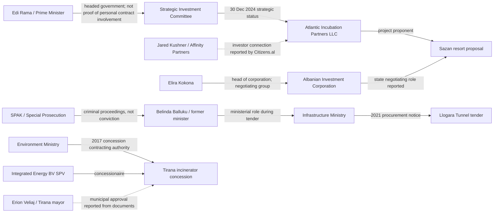

# Albania: Documented Power, Contracts & Projects Network
**Research snapshot: 23 October 2026**  
**Status:** Evidence-indexed investigative network, not a finding of guilt. Each edge below has a source and an explicit limitation. Sources must be rechecked for later updates.

## Visual network

**Legend:** Solid arrows = official/institutional relationship or documented role; dotted arrows = reporting about a relationship or document not independently inspected in this file. Arrow labels are the actual claim, not an assertion of guilt.

## Evidence register: document-backed edges

| ID | From | Relationship | To | Date | Evidence | Classification / limitation |
|---|---|---|---|---|---|
| S01 | Strategic Investment Committee | Granted strategic investor/special procedure status | Atlantic Incubation Partners LLC, Sazan resort | 30 Dec 2024 | [Decision described and linked at Save Albania](https://savealbania.com/evidence-item.php?id=1) | Official decision referenced by evidence repository; verify full decision and annexes |
| S02 | Jared Kushner / Affinity Partners | Investor association reported | Sazan / Atlantic Incubation Partners | 16 Jan 2025 | [Citizens.al investigation](https://citizens.al/en/2025/01/16/from-visitor-to-strategic-investor-how-Jared-Kushner-secured-Sazan/) | Secondary reporting; do not infer all ownership percentages |
| S03 | Elira Kokona | Led state-side negotiating team | Sazan negotiations / Albanian Investment Corporation | Jan–Oct 2025 | [Citizens.al, 3 Mar 2026](https://www.citizens.al/en/2026/03/03/nje-ishull-teresisht-privat-permasat-reale-te-projektit-ne-sazan/) | Investigative report describing official records; obtain minutes and appointments |
| S04 | National Territorial Council | Approved development permit, not construction permit | Sazan proposal | 30 Mar 2026 | [Albanian government explanatory record](https://kryeministria.al/en/newsroom/fakte-dhe-informacion-mbi-sazanin-dhe-zvernec/) | Government account; distinguish permit types |
| S05 | Environmental authorities | Required in-depth EIA | Relevant coastal development project described in government's Sazan/Zvërnec account | 15 May 2026 | [Government explanatory record](https://kryeministria.al/en/newsroom/fakte-dhe-informacion-mbi-sazanin-dhe-zvernec/) | Do not conflate Sazan and Zvërnec; verify precise parcel/project in decision |
| L01 | Ministry of Infrastructure and Energy | Published procurement notice REF-98814-06-22-2021 | Llogara Tunnel | 24 Jun 2021 | [Ministry procurement notice](https://www.infrastruktura.gov.al/en/shpallje/) | Primary ministry source; award and contractors require separate records |
| L02 | SPAK | Prosecuted alleged procurement-equality violation | Belinda Balluku / Llogara tender | 31 Oct 2025 | [SPAK statement reported with proceeding numbers](https://tiranapost.al/english/aktualitet/spak-sqaron-belinda-balluku-u-mor-e-pandehur-per-shkelje-te-barazise--i540809) | Prosecutorial allegation; presumption of innocence |
| L03 | SPAK | Formally charged on offences involving construction contracts | Belinda Balluku | 20 Oct 2026 | [Reuters](https://www.reuters.com/world/albania-formalises-corruption-charges-against-ex-deputy-pm-balluku-2026-10-20/) | News report of charges; not conviction; defendant denies wrongdoing |
| T01 | Ministry of Environment | Signed 30-year concession contract | Integrated Energy BV SPV / Tirana waste facility | 31 Aug 2017 | [Open Data Albania contract analysis](https://ndiqparate.al/?lang=en&p=17198) | Contract relationship; obtain signed contract |
| T02 | Rama / government | Approved an 8% competitive selection bonus, according to published signed documents | Tirana incinerator proposal | 7 Dec 2016 | [CNA report of documents released by opposition](https://www.cna.al/english/aktualitet/dokumentet-firmat-e-rames-veliajt-dhe-agacit-per-aferen-me-incenerato-i383683) | Secondary reporting on opposition-provided documents; independently inspect originals before asserting document authenticity |
| T03 | Erion Veliaj / Municipality of Tirana | Expressed agreement with feasibility/procedure and waste fee, according to reported correspondence | Tirana incinerator | 2017 | [CNA report](https://www.cna.al/english/aktualitet/dokumentet-firmat-e-rames-veliajt-dhe-agacit-per-aferen-me-incenerato-i383683) | Reported correspondence, not judicial finding |
| T04 | European Commission | Reported SPAK incinerator investigations and convictions of several officials | Tirana incinerator case | 2025 report | [European Commission Albania report 2025](https://eur-lex.europa.eu/legal-content/EN/TXT/PDF/?uri=CELEX%3A52025SC0750) | Official monitoring report; check individual judgments before naming convicted persons |
| P01 | Ministry of Finance | Publishes active concession/PPP budget exposure | National PPP portfolio | 2024/25 | [Fiscal Risk Statement 2024](https://financa.gov.al/wp-content/uploads/2025/12/Fiscal-Risk-Statement-2024.pdf) | Primary financial source, not proof of misconduct |

## Unproven links intentionally excluded

- **Bektashi sovereignty proposal → Kushner/Sazan:** No contract, financing document or legislative text found connecting these initiatives.
- **Jewish historical speech → a future Jewish state:** No verified proposal or decision.
- **Shared photographs or meetings → ownership, bribery or conspiracy:** Not a valid evidentiary edge.
- **A company in Panama/Pandora Papers → corruption:** Offshore registration alone is not unlawful.
- **Criminal charge → guilt:** Requires final judicial findings.

## Verification and expansion queue

1. Download and archive AIDA/KIS 30 Dec 2024 Sazan decision, annexes, state negotiation authorizations and beneficial-owner filings for Atlantic Incubation Partners.
2. Obtain Sazan negotiation minutes and identify legal counterparties, state asset terms, EIA, permits, protected-area and military status decisions.
3. Retrieve Llogara procurement notice, award, contract, bidder list, beneficial ownership, amendments, actual payments and SPAK case releases.
4. Obtain original Tirana incinerator contract, Council of Ministers decisions, concession bonus document, municipal correspondence and court judgments.
5. Join each contract to the Ministry of Finance PPP expenditure tables and the QKB beneficial-owner registry.
6. Record every new edge with a unique ID, source URL, document number/date, evidence type, access date, and correction/rebuttal field.
7. Reconcile contradictory government, court and investigative accounts; avoid publishing unsourced accusations.

**Editorial note:** This graph depicts relationships of office, procurement, investment and investigations. It is not a map of criminal associations.
