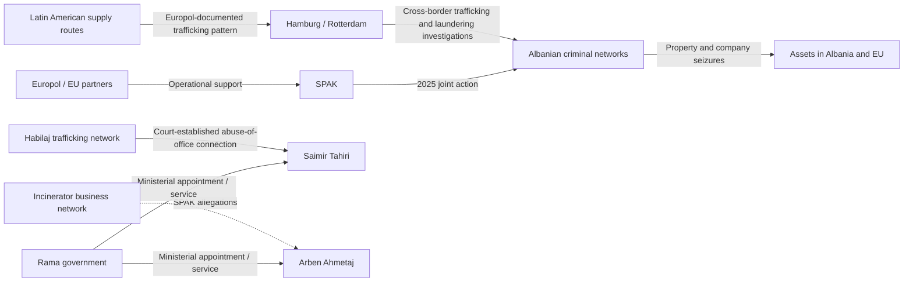

# Albanian Organized Crime: Global Networks, Money and Government Accountability

**Research date:** 23 October 2026  
**Scope:** Public sources only. This document does not imply that ethnic Albanians collectively participate in organized crime. It distinguishes convictions, formal charges, investigations and unverified allegations.

## 1. International networks — independently documented

### Europol, August 2025
On 7–8 August 2025, Albanian authorities with Europol and partners from Belgium, France, Germany, Italy and the Netherlands arrested 10 suspects in a transnational cocaine trafficking and laundering investigation. Europol described shipments from Latin America to Hamburg and Rotterdam and the seizure of properties, businesses and other assets. The investigation used Sky ECC communications. Arrests and seizures do not themselves establish guilt.  
**Primary source:** https://www.europol.europa.eu/media-press/newsroom/news/internationally-active-albanian-organised-crime-network-busted-10-arrests

### Eurojust, May 2026
A joint Italy–Albania operation arrested 12 suspects and issued summonses to three others. Eurojust reports five joint investigation teams involving the Bari anti-mafia prosecutor and SPAK between 2018 and 2026, more than 170 arrests and more than seven tonnes of seized drugs. A specific investigation described nearly €1 million allegedly laundered from Italy into Albania through a network in Tirana.  
**Primary source:** https://www.eurojust.europa.eu/news/eurojust-supports-joint-italy-albania-operation-dismantling-organised-crime-network

### Dritan Gjika and Latin American connections
OCCRP/Shteg report SPAK's allegations involving Dritan Gjika, cocaine trafficking through Latin America and Europe, and seizure orders targeting approximately €150 million in assets. Gjika was reported arrested in Abu Dhabi in May 2025 and facing Ecuadorian allegations. These are prosecutorial allegations; individual case outcomes require verification.  
**Source:** https://www.occrp.org/en/news/albanian-authorities-target-alleged-cocaine-kingpins-network

## 2. Political and government links: distinct evidentiary categories

| Person | Government role | Documented connection | Legal status / limitation | Source |
| --- | --- | --- | --- | --- |
| Saimir Tahiri | Former interior minister under Edi Rama | Court found abuse of office in connection with Habilaj drug trafficking network; court did not convict him of drug trafficking | Conviction for abuse of office reported by OCCRP; distinguish offence and judgment date | https://www.occrp.org/en/news/albanias-ex-interior-minister-jailed-for-helping-drug-traffickers |
| Arben Ahmetaj | Former deputy prime minister and minister | SPAK alleged corruption, money laundering and concealment of assets related to waste-incinerator concessions and payments from connected businessmen | Charges and prosecutorial allegations, not proof of guilt | https://www.transparency.org/en/cepi/cases/albania-arben-ahmetaj-deputy-pm-involved-inincinerators-concession-scandal- |
| Lefter Koka | Former environment minister | Waste-incinerator concession corruption case | Conviction reported by Transparency International; identify exact case and appeals before describing finality | https://www.transparency.org/en/cepi/cases/albania-arben-ahmetaj-deputy-pm-involved-inincinerators-concession-scandal- |
| Alqi Bllako | Former Socialist MP | Incinerator-related investigation and reported court proceedings | Verify exact current verdict and appeal status | https://www.transparency.org/en/cepi/cases/albania-arben-ahmetaj-deputy-pm-involved-inincinerators-concession-scandal- |
| Edi Rama | Prime minister since 2013 | Headed the government during these officials' service and relevant concessions | **No direct participation in criminal organizations established by these sources**. Political accountability is distinct from criminal liability. | EU Albania Report 2025 |

## 3. Government response and countervailing evidence

The European Commission's Albania Report 2025 describes Albania as **moderately prepared** to fight organized crime, noting progress in SPAK's financial investigations, asset seizures and international cooperation, but continuing weaknesses in money-laundering enforcement, convictions and operational capacity. In 2024–2025, Albania participated in 25 Eurojust-supported joint investigation teams, including 16 in narcotics. This evidence of enforcement progress must be reported alongside criminal allegations.

**Primary source:** https://eur-lex.europa.eu/legal-content/EN/TXT/?uri=celex%3A52025SC0750

## 4. Evidence graph — verified and reported relationships

**Legend:** Solid links = reported institutional action or court outcome; dotted links = allegation requiring adjudication. The global trafficking routes shown are a documented pattern, not a claim that all cases belong to a single hierarchy.

## 5. Next research questions

1. Which named individuals, legal entities and company registration numbers appear in public SPAK court filings?
2. Which confiscated or seized assets can be matched to land parcels, construction firms, hotel developments or government contracts?
3. Do judicial records document any actual communication, payment or contract between criminal actors and named public officials? A shared photograph or acquaintance does not suffice.
4. What were the outcomes of appeals, confiscation proceedings and cross-border extraditions?
5. What are the responses and denials of the people named in official or publicly available records?
6. What is the trend in SPAK cases, convictions and recovered assets since 2013? Separate enforcement successes from corruption exposure.
7. Which public-sector tenders and concessions can be connected to criminal assets through company identifiers and court orders, rather than similarity of names?

## 6. Publication rules

- Do not call someone a mafia member based solely on press coverage, ethnicity, family relationships or accusations.
- Distinguish **arrest**, **charge**, **conviction**, **appeal** and **final conviction**.
- Do not infer Rama's personal involvement from actions of officials serving in his government.
- Use public court records and official statements to ground every individual/company edge.
- Treat property seizure as a legal process, not a finding that every asset was criminally obtained.
- No outreach or information requests will be sent; only publicly accessible records will be used.
